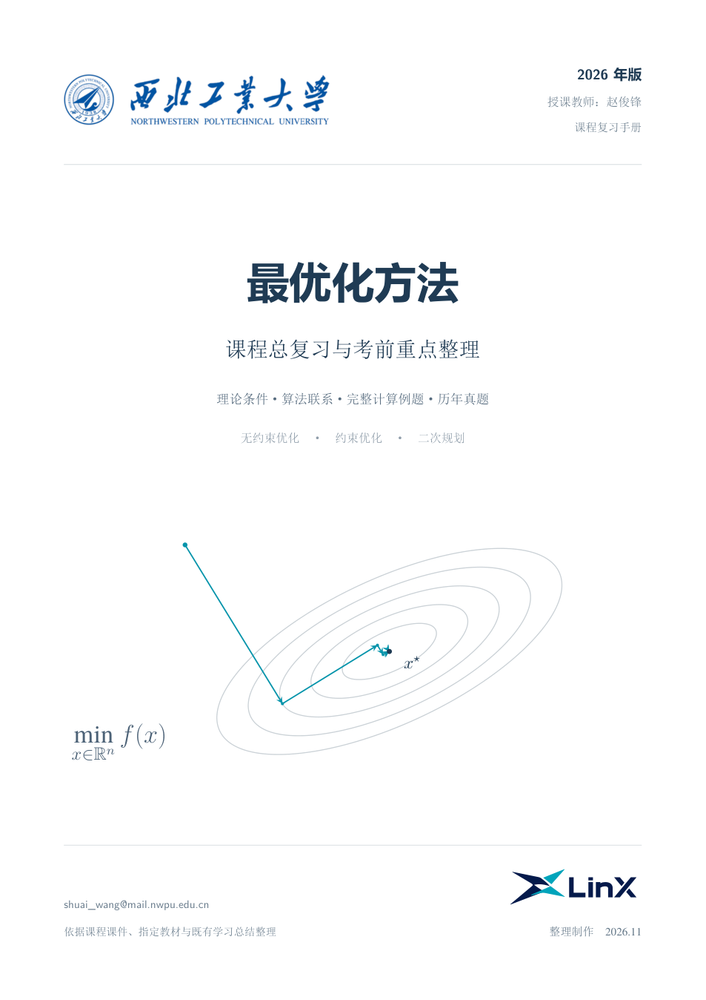
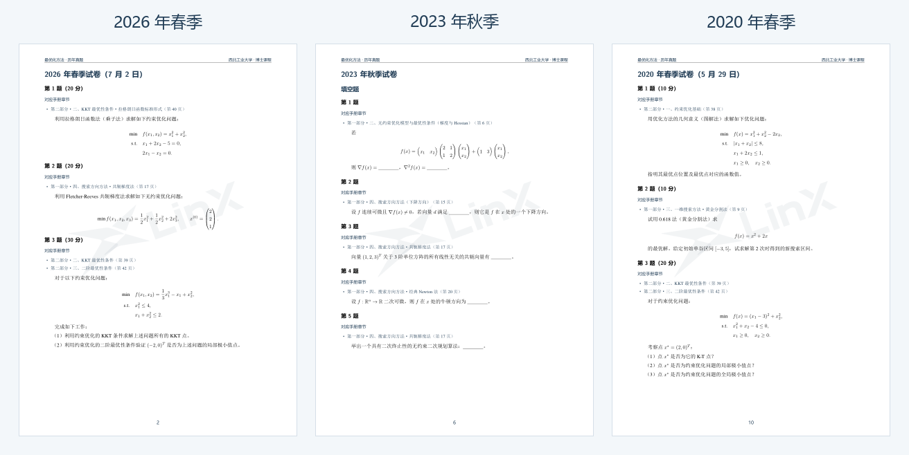
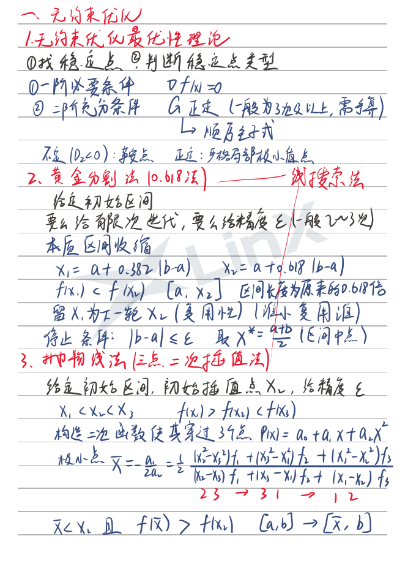
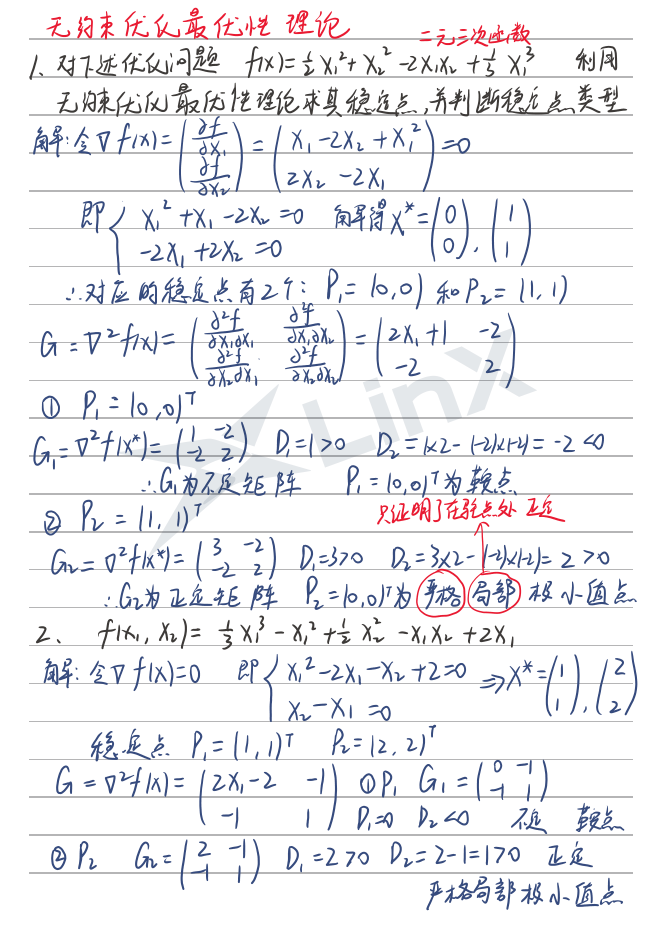

  <picture>
    <source media="(prefers-color-scheme: dark)" srcset="assets/linx-white.svg">
    <source media="(prefers-color-scheme: light)" srcset="assets/linx-color.svg">
    
  </picture>

西北工业大学 · 博士课程学习资料

# 最优化方法

**老师划定重点 · 完整计算例题 · 历年真题**

整理制作：**LinX**　｜　**2026 年秋季整理**

[阅读复习手册](最优化方法_课程复习手册.pdf) · [阅读历年真题](最优化方法_历年真题.pdf) · [查阅课程教材](最优化_建模算法与理论.pdf)

**点击封面阅读手册** · 104 页 · 含老师划定重点与历年试题

---

## 从重点复习，到真题练习

面向西北工业大学博士生学习、复习《最优化方法》的资料集。以**课程复习手册**串联理论条件、算法与计算例题，搭配 LinX 的**平板手写要点、习题练习**及课程教材，方便后续同学查阅和使用。

<table align="center">
  <thead><tr><th align="center">手册中可以找到</th><th align="center">内容</th></tr></thead>
  <tbody>
    <tr><td align="left"><strong>老师划定重点</strong></td><td align="left">整理时收集的教师复习要求、重点题型与公式使用提醒。</td></tr>
    <tr><td align="left"><strong>知识与算法</strong></td><td align="left">无约束优化、约束优化、二次规划；公式速记、算法停止条件与思维导图。</td></tr>
    <tr><td align="left"><strong>计算与真题</strong></td><td align="left">完整计算例题，以及手册末尾收录的试题与考试回忆。</td></tr>
  </tbody>
</table>

<h2 align="center">历年真题</h2>

独立 PDF · 2019—2026 · 13 页

**[直接阅读 / 下载《历年真题》PDF · 13 页](最优化方法_历年真题.pdf)**

按独立文件整理，包含试题、考试回忆与对应复习章节，保留原有水印，使用独立页眉和连续页码。完整手册仍保留全部内容。

2026 春 · 2023 秋 · 2020 春试题节选预览，点击图片打开真题 PDF

<table align="center">
  <thead><tr><th align="center">年份与学期</th><th align="center">收录内容</th><th align="center">真题 PDF 位置</th></tr></thead>
  <tbody>
    <tr><td align="center"><strong>2026 年秋季</strong></td><td align="center">11 月 15 日考试回忆版</td><td align="center"><a href="最优化方法_历年真题.pdf#page=1">第 1 页</a></td></tr>
    <tr><td align="center"><strong>2026 年春季</strong></td><td align="center">7 月 2 日试题</td><td align="center"><a href="最优化方法_历年真题.pdf#page=2">第 2 页</a></td></tr>
    <tr><td align="center"><strong>2025 年春季</strong></td><td align="center">6 月 19 日试题</td><td align="center"><a href="最优化方法_历年真题.pdf#page=4">第 4 页</a></td></tr>
    <tr><td align="center"><strong>2023 年秋季</strong></td><td align="center">填空题、证明题与计算题</td><td align="center"><a href="最优化方法_历年真题.pdf#page=6">第 6 页</a></td></tr>
    <tr><td align="center"><strong>2020 年春季</strong></td><td align="center">5 月 29 日试题</td><td align="center"><a href="最优化方法_历年真题.pdf#page=10">第 10 页</a></td></tr>
    <tr><td align="center"><strong>2019 年春季</strong></td><td align="center">春季试题</td><td align="center"><a href="最优化方法_历年真题.pdf#page=12">第 12 页</a></td></tr>
  </tbody>
</table>

独立真题 PDF 从第 1 页起连续编号，表中页码与文件页码一致。2026 年秋季为考试回忆，具体函数、初始点及部分条件未记录，文件中已注明。GitHub 预览如未跳转，可下载后按页序定位。

## 资料下载

<table align="center">
  <thead><tr><th align="center">资料</th><th align="center">规模</th><th align="center">内容与使用建议</th></tr></thead>
  <tbody>
    <tr><td align="left"><strong><a href="最优化方法_课程复习手册.pdf">课程复习手册</a></strong></td><td align="left">104 页</td><td align="left">系统复习主线，含老师划定重点、理论条件、算法联系、完整计算例题、公式整理与历年真题。</td></tr>
    <tr><td align="left"><strong><a href="最优化方法_历年真题.pdf">历年真题</a></strong></td><td align="left">13 页</td><td align="left">独立整理的历年试题与考试回忆，涵盖 2019、2020、2023、2025、2026 年，保留原有水印。</td></tr>
    <tr><td align="left"><strong><a href="#keypoints-preview">要点 · 首页预览与下载</a></strong></td><td align="left">10 页 · 18.3 MiB</td><td align="left">LinX 使用平板直接书写的复习笔记，归纳概念、公式与解题步骤，适合学后回顾和考前速查。</td></tr>
    <tr><td align="left"><strong><a href="#exercises-preview">习题练习 · 首页预览与下载</a></strong></td><td align="left">61 页 · 81.0 MiB</td><td align="left">LinX 使用平板直接书写的习题与演算记录，适合独立计算后对照检查方向、步长、矩阵与乘子。</td></tr>
    <tr><td align="left"><strong><a href="最优化_建模算法与理论.pdf">课程教材：最优化——建模、算法与理论</a></strong></td><td align="left">577 页 · 8.3 MiB</td><td align="left">课程教材 PDF，刘浩洋、户将、李勇锋、文再文编著。适合系统学习理论、查阅推导与算法细节，并与复习手册对照使用。</td></tr>
  </tbody>
</table>

**下载单份资料**：打开文件后选择下载。**打包下载**：仓库首页选择 **Code → Download ZIP**。

**课程教材**：[在线阅读《最优化：建模、算法与理论》](最优化_建模算法与理论.pdf) · [直接下载 PDF](https://github.com/LinX-Wang/nwpu-optimization-methods/raw/refs/heads/main/最优化_建模算法与理论.pdf?download=1)。文件保持原始版本，内容未作修改。

《要点》《习题练习》均为平板手写 PDF。下方提供首页图片与直接下载入口；若 GitHub 提示无法预览，请直接下载后用本地 PDF 阅读器打开。

### 要点 · 首页预览

  <strong>10 页 · 18.3 MiB</strong> 
  <a href="https://github.com/LinX-Wang/nwpu-optimization-methods/raw/refs/heads/main/%E8%A6%81%E7%82%B9.pdf?download=1"><strong>直接下载 PDF</strong></a> · <a href="要点.pdf">尝试在线预览</a> · <a href="assets/keypoints-first-page.png">查看高清首页</a>

  

### 习题练习 · 首页预览

  <strong>61 页 · 81.0 MiB</strong> 
  <a href="https://github.com/LinX-Wang/nwpu-optimization-methods/raw/refs/heads/main/%E4%B9%A0%E9%A2%98%E7%BB%83%E4%B9%A0.pdf?download=1"><strong>直接下载 PDF</strong></a> · <a href="习题练习.pdf">尝试在线预览</a> · <a href="assets/exercises-first-page.png">查看高清首页</a>

  

使用 Git 获取全部资料

<pre>git clone https://github.com/LinX-Wang/nwpu-optimization-methods.git</pre>

## 建议学习顺序

1. **建立框架**：从教材基础章节开始，熟悉梯度、Hessian、凸性等工具。
2. **逐章理解**：依次学习一维搜索、无约束优化、约束最优性条件、罚函数与乘子法、二次规划等内容；配合手册理解算法。
3. **动手演算**：结合手册例题与平板手写习题练习，完整写出每一步，核对符号与终止条件。
4. **考前复习**：围绕老师划定重点，用《要点》回顾，再通过手册末尾的往年试题检验掌握情况。

> 考试重点与范围以当学期课程通知为准，手册中的考试提醒反映整理时收集的信息。

---

### 资料来源与勘误

- **课程教材**：《最优化：建模、算法与理论》，刘浩洋、户将、李勇锋、文再文编著，著作权归原作者及相关权利人。
- **复习手册**：由 LinX 依据课程教材和学习记录整理。
- **手写资料**：《要点》《习题练习》由 LinX 使用平板手写。

本仓库为个人学习资料整理，资料的收录不改变原有署名与权利归属。

发现公式、演算或目录说明有误，欢迎[提交 Issue](https://github.com/LinX-Wang/nwpu-optimization-methods/issues)，注明**文件名、PDF 页码和具体问题**，方便后续核对更新。
